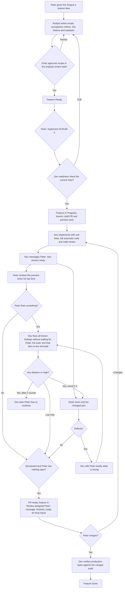
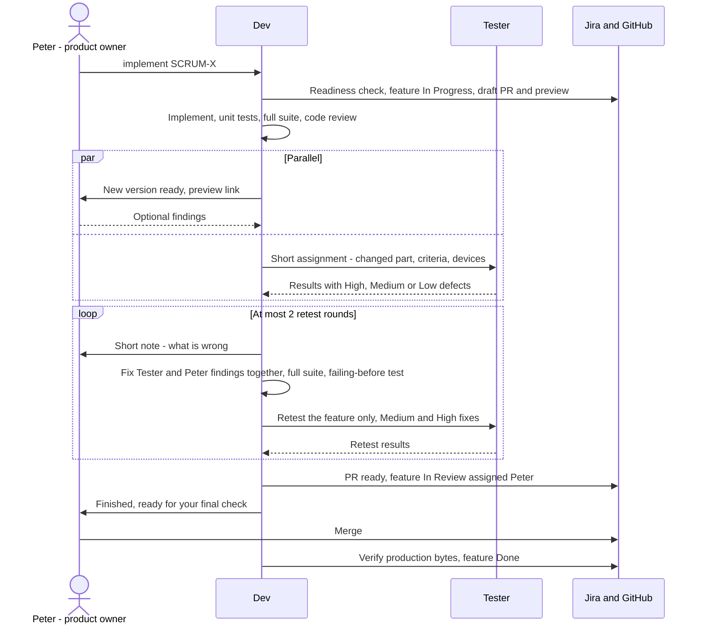

# Bearmatics 🐻

A child-friendly math practice web app for ages **6–9**, in **Slovak and English**, with selectable learning levels, missing-number exercises, progressive counting hints, and animated bear/sound feedback.

**Status:** MVP scope approved in [specification #6](https://github.com/PeterMacko/Bearmatics/issues/6). The foundation (#7), math engine (#8), and interactive practice interface (#9) are implemented and verified in the accepted Chromium/Firefox QA scope (#12). Choose a level and 5/10/20 exercises, practise with retries and explicit Next, switch Slovak/English without resetting progress, and view a completion summary. Progressive hints (#10), sound and expressive bear reactions (#11) are implemented and covered by accepted QA. The original bear has neutral/happy/gently sad states, short reactions, and reduced-motion alternatives. Peter accepted scoped independent QA in #12. Feature-branch publication is not a merge or production deployment.

## Learning levels and mistake review

The implemented [SCRUM-26 progression](docs/level-progression.md) extends Peter's revision in [#15](https://github.com/PeterMacko/Bearmatics/issues/15). This feature still requires exact-revision owner review and independent QA; the earlier MVP acceptance below does not accept these changes:

| Level | Practice |
| --- | --- |
| 0 | Picture addition, all quantities 0–6, missing result only |
| 1 | Addition only, up to 10; any missing term |
| 2 | Addition and subtraction, up to 10; any missing term |
| 3 | Addition and subtraction, up to 20; missing result only |
| 4 | Addition and subtraction, up to 20; missing first or second operand |
| 5 | Addition and subtraction, up to 100; any missing term |
| 6 | Multiplication with factors 1–5; any missing term |
| 7 | Multiplication and exact division with factors 1–10; any missing term |

Every original generated round has **at most one question involving zero**, counting all three stored values, including the hidden answer; several zeros in one fact still count as one question. Levels 6–7 remain strictly positive. Level 0 includes zero as an explicitly empty group, with all 28 ordered addition facts still mathematically legal (swapped operands remain distinct). Rounds of 5 or 10 remain unique on every level, as do 20-question rounds on levels 1–7. For level 0 only, Peter approved keeping 20 questions: all 15 distinct nonzero facts plus one zero-containing fact and exactly four additional nonzero presentations, each repeating a different fact, separated rather than immediately repeated. The zero fact never repeats within the original round. Numeric entry and the usual keypad remain available. Original local pirates, bears, lollipops, boats and aircraft cycle by original exercise index, staying unchanged through retries, review and settings. Supplied groups remain visible; the main result pictures appear only after a correct submission and hide again on Next or a fresh review presentation. The optional final worked numerical hint remains available without revealing main result pictures. Initial selection remains level 1.

A mathematical mistake does not end the exercise: the child can retry immediately. Once the original session is finished, each missed presentation returns in a review queue, with the exact same equation and missing-number position. Review is not a new generated question: a missed zero fact may return as often as the existing mastery rules require, and repeated level-0 original presentations retain separate identities and themes. A correct first valid attempt removes it from review; another mistake causes it to cycle to the back after the immediate retry. Invalid input does not count as an attempt. Completion appears only when the review queue is empty. Original first-try statistics are not inflated by review answers. Leaving/restarting remains possible and discards in-memory progress.

The revised visual direction uses coral, sunshine yellow and sky blue rather than green primary styling. Three teaching-hint stages are now available in Slovak and English: strategy → visual part/whole or equal-group model → worked solution. Known quantities use dots and tens blocks; earlier stages keep the missing value hidden. Worked solutions use the appropriate inverse operation for a missing operand, with smaller tens/ones or bridging-ten steps where useful. Hints never fill or submit an answer and reset on the next exercise; switching language preserves the hint stage and typed answer.

Hint-assisted answers are excluded from original first-try counts. A hinted review answer must return for a fresh unassisted attempt before clearing the mastery queue. Hint use alone does not add an otherwise-correct original exercise to the mistake queue. Expressive bear/sound reactions are implemented in #11 and covered by the accepted QA scope in #12.

## Answer feedback and sound

Answer controls are neutral blue before checking, green on success, and red after a valid wrong answer. Editing the answer returns controls and the bear to neutral. Invalid input gets a short localized prompt, without an example, punishment, sound or sad reaction. Text feedback remains available alongside colour, sound and animation.

Sound preference starts **on by default**. Browser audio activates only from a genuine interaction such as Start; it does not autoplay on page load. Settings distinguishes requested, ready, unavailable and muted states. Muting before Start is respected, and mute stops active/scheduled tones immediately. Correct/retry cues use stronger bounded synthesized tones; a distinct two-second completion fanfare plays once after the original session and all required mastery review are finished, without replaying on settings/language changes or unmute. No background music, microphone access, audio downloads or recordings are used. If the browser blocks audio, practice continues with visual feedback. The bear has short non-looping success/retry reactions; reduced-motion settings disable movement while keeping the expressions. Human listening and device volume remain separate review checks.

The bear SVG, expression variations and procedural sound patterns were created for Bearmatics; no third-party image or audio assets are included. A repository-wide license has not been selected by this task.

## Team

| Participant | Responsibility |
| --- | --- |
| Peter (product owner) | Approves scope, reviews each new version **in parallel with QA**, gives the final OK and merges/releases. |
| `dev` | Coordinates work, implements, runs developer checks and the full automatic suite, fixes defects, verifies evidence and releases. |
| `bearmatics-analyst` | Prepares backlog features in Jira: scope, acceptance criteria, subtasks and dependencies; moves approved features to Ready. |
| `bearmatics-tester` | Independently tests **only the changed part** of each delivered version and reports rated, reproducible defects. |

## Delivery workflow

Peter's rules (2026-11-14): QA and Peter's review run at the same time; the Tester tests only what changed; Dev never waits for Peter to fix Tester findings; only Medium/High fixes go back to the Tester; at most 2 retest rounds before asking Peter.

### Activity diagram



### Sequence diagram



**Rules behind the diagrams**

1. **Scope:** proposals become requirements only when Peter marks the analysis review task Done.
2. **Early preview:** draft PR and branch preview from the first meaningful commit; they are not approval, QA or release.
3. **Parallel review and QA:** when a version is ready, Dev messages Peter and sends the Tester a short assignment at the same time. The Tester does not wait for Peter.
4. **QA scope:** the Tester tests only the changed part (feature acceptance criteria at the defined devices plus screens sharing the changed code). Dev's full automatic suite covers the rest and is not re-run by the Tester.
5. **Fixes:** Dev reports defects to Peter in one short message and fixes them without waiting for him; Peter's findings that arrive during QA are fixed together with the Tester's. Every fix gets Dev's full suite and a test that fails on the old build. Only Medium/High fixes return to the Tester, who retests the feature only. After 2 retest rounds Dev asks Peter.
6. **Peter's tweaks after QA passed** (sizes, colours, texts, audio): Dev tests plus Peter's eye/ear; the Tester only if behaviour changes. Changes that do not alter the app bundle skip QA.
7. **Final handoff:** when QA passed and Peter has nothing open, the PR is ready and the feature is **In Review, assigned Peter**. Agents never merge or release. After the merge Dev verifies the production files and closes the feature.

**Models and limits:** Dev and Analyst use Claude Opus 5.5, the Tester uses Claude Sonnet 5.5. If a usage limit is hit, work resumes from the same checkpoint after the reset.

## Work tracking: Jira and GitHub

- New planning, agent-owned tasks, decisions and verification evidence live in [Jira project SCRUM](https://project-22.atlassian.net/jira/software/projects/SCRUM/boards/1). Code, commits, pull requests and Cloudflare build checks stay in this GitHub repository. The original GitHub issue history remains intact; its Jira copy is historical, not automatic two-way synchronization.
- Use native feature/child relationships and explicit Developer, Analyst, Tester or Peter ownership. Agent-owner metadata is separate from the authenticated Jira author and does not automatically launch a Hermes worker. Do not use an unassignable service account as an assignee; preserve owner labels/descriptions until the shared Agent owner dropdown is available.
- Keep scope, acceptance criteria, dependencies and evidence concise. Comment only for decisions, blockers, handoffs, approvals and verified results; identify the acting participant. Dev reads back evidence before closing work.
- Current feature: [SCRUM-36](https://project-22.atlassian.net/browse/SCRUM-36), responsive menu scrolling, compact bear header and favicon. Analysis review [SCRUM-41](https://project-22.atlassian.net/browse/SCRUM-41) is approved; development review is separate in [SCRUM-44](https://project-22.atlassian.net/browse/SCRUM-44); [SCRUM-42](https://project-22.atlassian.net/browse/SCRUM-42) owns independent QA. The earlier eight-level contract remains in [development scope](docs/level-progression.md); its acceptance does not accept this new visual feature.
- Creating or assigning a Jira item does not itself approve unresolved product rules, start acceptance QA, or authorize code publication, merges, cloud provisioning or production deployment. The separate-release gate above remains unchanged; checked draft PR/feature preview publication follows the approved early-preview workflow.

## Accepted QA scope

Independent QA of the owner-approved snapshot passed in Chromium and Firefox with no confirmed product defects. It included independent arithmetic/hint checks and practice/review flows, in addition to rerunning developer tests. Peter accepted the documented coverage limits: WebKit/Safari could not launch due to missing host libraries; physical-device behaviour, human sound-quality review and a full accessibility audit remain unverified. This is not a claim of universal browser compatibility or release authorization. Evidence and decisions are recorded in [#12](https://github.com/PeterMacko/Bearmatics/issues/12) and [#14](https://github.com/PeterMacko/Bearmatics/issues/14).

No hosted GitHub Actions CI workflow is included in this initial app publication; test/build evidence comes from local developer and isolated independent-QA runs.

## Hosting and data

Hosting: **Cloudflare Workers with Static Assets**, connected to this GitHub repository by Peter. The MVP is live at https://bearmatics.mr-petermacko.workers.dev (release verification in #13).

Server and database (SCRUM-96, foundation only): a small Worker script (`worker/index.ts`) answers only `/api` and `/api/*` (`assets.run_worker_first`); every other address is served by static assets exactly as before. `GET /api/health` reports whether the server and database are reachable and the schema version (no data); unknown `/api` addresses return a JSON 404. The database is Cloudflare D1 (SQLite): the live app uses `bearmatics`, all branch previews share `bearmatics-preview` (`previews.d1_databases`), and local development uses a local SQLite file under `.wrangler/`. Schema changes are numbered SQL files in `migrations/`, applied with Wrangler; applying is safe to repeat. No user data is stored yet; accounts come with SCRUM-97. Do not store children's personal data by default, and never put personal data in `/api` URLs or logs (invocation logs record URLs).

## Local development and developer checks

Use Node.js `^26.12.1` (supported Node 26.x starting at 26.12.1; validated here with Node 26.12.1 and npm 11.19.1). Install the exact dependency tree from the committed lockfile:

```sh
npm ci
npm run dev
```

The development server binds to localhost. To verify the foundation:

```sh
npm run format:check
npm run lint
npm test
npm run build
npx playwright install chromium
npm run test:e2e
npm run deploy:check
npm run test:server
```

`npm run test:server` runs the server tests in Node: handler unit tests, a configuration guard (previews never point at the live database, TOML matches JSONC, only `/api` reaches the script) and an integration test that starts the real Worker runtime with an empty local D1, applies the migrations twice and checks `/api/health`, the JSON 404 and unchanged app files. It needs a built `dist/` (`npm run build` first). To run the server locally: `npm run build`, `npm run db:migrate:local`, then `npx wrangler dev` and open `http://localhost:8787/api/health`. After changing bindings in `wrangler.jsonc`, run `npm run types:worker` to regenerate `worker/worker-configuration.d.ts`.

Code is formatted with Prettier (pinned dev dependency; `.prettierrc.json`, 100-character lines). Run `npm run format` before committing; `format:check` must pass. Markdown docs, generated output and Cloudflare config are excluded in `.prettierignore`. The one-time reformat commit is listed in `.git-blame-ignore-revs`; use `git config blame.ignoreRevsFile .git-blame-ignore-revs` for useful blame.

Code is linted with oxlint (pinned dev dependency; `.oxlintrc.json`): correctness rules, TypeScript and React rules, React hook rules and unused variables/imports, all as errors. `npm run lint` must pass with zero findings. If a rule conflicts with intended behaviour, keep the code and add `// oxlint-disable-next-line <rule> -- <reason>`; never change hook dependencies without a test proving behaviour is unchanged.

The browser smoke test starts/stops a local production preview automatically. On Linux, Playwright may require OS browser dependencies; install them through your administrator if the browser reports missing libraries. `deploy:check` is a Wrangler dry run, not a cloud deployment. These are developer checks, not independent QA signoff. Developer browser tests complete real sessions on every level, cover 5/10/20 exercise counts, language switching, modal keyboard focus and a 320px Slovak layout. Unit/component tests cover the pure math engine, invalid input versus wrong answers, retries, exact session completion, first-try counts, language state and leave confirmation. This is developer verification, not independent QA or a complete accessibility audit. Developer checks also cover hint formulas for each operator/blank, zero/boundary values, decomposition, stage/language preservation, hint-assisted scoring, review requeueing and narrow layouts. Developer checks also cover neutral/error/success control colours, bear expressions, reduced motion, opt-in native Web Audio, mute, blocked audio and duplicate-submission suppression.

Dependencies are pinned. npm 11 install-script approvals are limited to the locked esbuild/workerd versions in package.json. Do not broadly approve unrelated dependency scripts. `npm audit` can be run to check the current dependency advisories.

## Cloudflare connection settings

`wrangler.jsonc` is the canonical configuration and includes the required `previews: {}` block for branch previews. `wrangler.toml` is an equivalent alternative; keep both in sync and use `--config wrangler.toml` to select TOML explicitly (Wrangler otherwise discovers JSONC first). Both enable persistent invocation logs with `observability.logs.enabled`, `invocation_logs` and `persist` set to `true`. Preview observability uses the top-level settings unless explicitly overridden. These are runtime/request logs, not browser audio logs or build logs; do not log children's answers or personal data. Cloudflare log retention/usage follows the account plan.

After the application PR is merged into `main` with Peter’s approval, and the first deployment is authorized, connect the repo as a Worker with these settings:

| Setting | Value |
| --- | --- |
| Worker name | `bearmatics` (must match wrangler.jsonc) |
| Root directory | Repository root |
| Production branch | `main` |
| Build command | `npm run build` |
| Deploy command | `npm run deploy` (applies live-database migrations, then `wrangler deploy`) |
| Preview command | `npm run deploy:preview` (applies preview-database migrations, then `wrangler preview`) |
| Preview builds | Enabled; preview URLs are public unless protected |
| Build variable | `NODE_VERSION=26.12.1` (or a compatible installed Node version) |
| Database bindings | D1 `DB`: live `bearmatics`, previews `bearmatics-preview` (IDs in `wrangler.jsonc`; `wrangler.preview-migrations.jsonc` must match the preview entry). Created by Peter in the Cloudflare dashboard. |

Wrangler serves static files from `dist` with SPA fallback; the server script only handles `/api`. The build token must be allowed to edit D1 so the deploy commands can apply migrations. Cloudflare installs dependencies before the build. The initial production release was verified in #13. Do not treat a successful dry run as a live release. Feature branches use preview builds (`npx wrangler preview`), never the production deploy command. Add the actual verified stable Preview URL to the draft PR; do not guess it from a branch name. A failed build leaves the last successful preview unchanged, so record the previewed revision and use a deployment-specific URL for exact owner/QA approval when available. Publishing to the production branch can trigger deployment once Git integration is connected; obtain release authorization first.

## Planning links

- [Team kickoff and conventions #1](https://github.com/PeterMacko/Bearmatics/issues/1)
- [MVP scope and task breakdown #5](https://github.com/PeterMacko/Bearmatics/issues/5)
