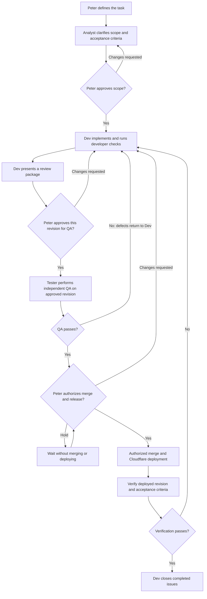

# Bearmatics 🐻

A planned child-friendly math practice web app for ages **6–9**, in **Slovak and English**, with selectable learning levels, missing-number exercises, progressive counting hints, and animated bear/sound feedback.

**Status:** requirements and workflow planning. Application code, install/build commands, and deployment are not available yet. Proposed defaults in [MVP #5](https://github.com/PeterMacko/Bearmatics/issues/5) still require agreement.

## Team

| Participant | Responsibility |
| --- | --- |
| Peter (product owner) | Approves scope, reviews Dev's delivered work **before independent QA**, and authorizes merge/release. |
| `dev` | Coordinates work, implements, runs developer checks, presents reviewable deliverables, and verifies evidence before closing tasks. |
| `bearmatics-analyst` | Clarifies requirements, learning rules, user flows, and acceptance criteria. |
| `bearmatics-tester` | Independently tests the owner-approved revision and reports verified results and reproducible defects. |

## Delivery workflow

### Required review gates

1. **Scope approval:** proposals are not requirements until Peter agrees.
2. **Peter's review before QA:** Dev supplies a short change summary, linked issue/PR or exact revision, a runnable demo/preview when available (screenshots when useful), and developer test/build results with limitations. Peter explicitly approves that revision for QA, or requests changes.
3. **Independent QA:** the tester may prepare a test plan beforehand, but must not start independent acceptance testing of delivered work until Peter's approval is recorded. Dev's unit tests, build checks, and automated CI are allowed before this gate; they do not replace QA.
4. **Rework:** implementation changes after Peter's approval, including QA fixes, return through Peter's review before independent QA/retesting. Record the approved revision so old approval is not applied to new code.
5. **Release approval:** Peter's approval to start QA is **not** approval to merge or deploy. Merge/release requires separate explicit authorization. If merging triggers Cloudflare production deployment, merge is also a release decision.

Record approval in the relevant issue/PR comment (for example, `Peter: approved revision <commit> for QA`) or in this team's chat, with a concise attributed record linked to the issue. GitHub credentials are currently shared through Peter's account, so a self-approval restriction must not be bypassed or treated as approval; a clear owner decision is required. These are team operating rules, not yet technically enforced branch-protection or CI gates.

## GitHub work tracking

- One parent issue per feature/outcome; native sub-issues for meaningful agent tasks and owner review.
- Titles use `[ANALYST]`, `[DEV]`, `[QA]`, or `[OWNER]`; `agent:*` labels identify agents. The body explicitly names the responsible participant. Hermes agents are not separate GitHub accounts.
- Keep scope, acceptance criteria, dependencies, and evidence concise. Comment only for decisions, blockers, handoffs, approvals, and verified results; identify the acting participant.
- A task's status is not proof of completion. Dev checks evidence before closing; all acceptance criteria and review gates must be satisfied before the parent closes.
- Creating an issue does not automatically start an agent or authorize code publication, merges, cloud resources, or deployments.

## Hosting and data

Planned hosting: **Cloudflare Workers with Static Assets**, connected to this GitHub repository by Peter. No server database or accounts are required for the initial app. A future authenticated Worker API with Cloudflare D1 can support saved progress. Do not store children's personal data by default.

This README-only commit does **not** make the repository deployable. Wait for application code, package/build scripts, and Wrangler configuration before completing the first Cloudflare build.

## Planning links

- [Team kickoff and conventions #1](https://github.com/PeterMacko/Bearmatics/issues/1)
- [MVP scope and task breakdown #5](https://github.com/PeterMacko/Bearmatics/issues/5)
